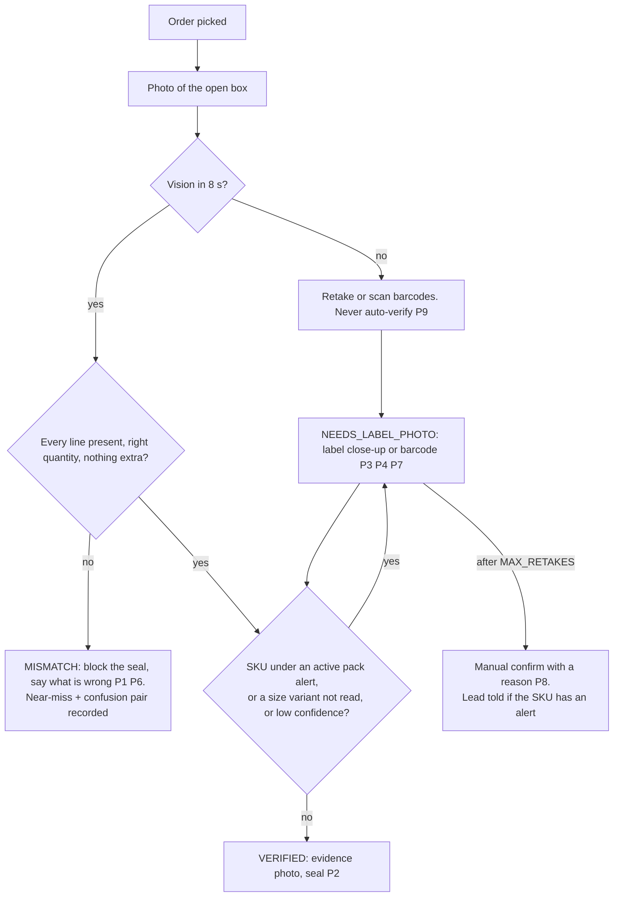
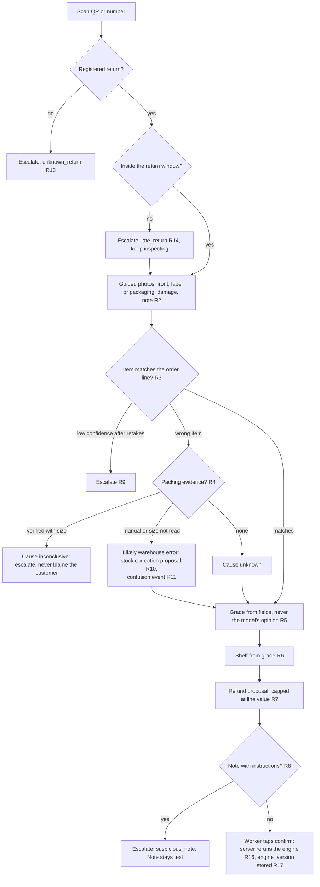
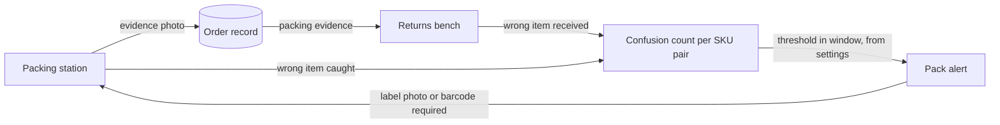

# Sjekkpunkt: architecture

Generated from the code at M8 (2026-11-07). Choices and their reasons are in `docs/decisions.md`.

## System

```
Android handheld / phone (PWA, Chrome, HTTPS)          Lead tablet / desktop
  packing + returns stations                             lead console, insights, admin, Holio mock
  camera (rear, EXIF removed), push-to-talk              live feed (Realtime), spoken summaries
          │                                                          │
          └───────────── Next.js 16 on Vercel (functions in arn1, Stockholm) ─────────────┘
                proxy.ts: session refresh, sign-in redirect, CSP with a per-request nonce
                API routes: guard() = role + zod  →  limits (rate, spend)  →  one SQL function
                shared rule engine lib/engine (pure TypeScript, also runs in the browser)
          ┌───────────────────────┼──────────────────────────────┐
          ▼                       ▼                              ▼
   Supabase (eu-north-1)     ElevenLabs                     Gemini
   Postgres + RLS + audit    agents over WebRTC (token       vision: fast model, strong fallback
   Auth, private Storage     from /api/voice/token),         translation of notes and captions
   Realtime (lead feed)      spoken summaries (TTS)          (server-side only)
```

**Demo mode** (`/demo`) is the same station UI on an in-memory adapter with scripted vision and audio: each station talks
to a port (`ReturnsPort`, `PackPort`) with a `demo` and a `live` implementation, and both run the same engine.

## How a decision is made and kept

1. The worker taps (or asks the coach). The browser runs `lib/engine` for an instant preview.
2. Photos go to a signed upload URL; `/api/vision` sends them to Gemini with the order's closed set of SKUs and up to four
   reference photos, zod-validates the answer, stores it, and deletes the photo if a face is in it.
3. On **confirm** or **seal**, the route ignores every decision field from the browser, rebuilds the engine input from
   stored rows and settings, reruns the engine (R16), and commits through one SQL function in one transaction: the
   decision, stock proposals, escalations, confusion events, integration events and the audit row.
4. A trigger on `confusion_events` (`app.check_pack_alert`) closes the loop in the same transaction.
5. Leads resolve escalations by tap; overrides need a reason and keep the refund capped (R15).

## Decision flow: packing



## Decision flow: returns (per item)



## The loop



Counted per SKU pair, never per worker. Threshold and window are settings (default 3 in 7 days).

## Where things live

| Path | What |
|---|---|
| `lib/engine` | Rules P1–P9, R1–R17, grade, injection check, loop. No React, Next or Supabase |
| `lib/vision`, `lib/translate`, `lib/voice` | Model clients, prompts, zod schemas, agent config and client tools |
| `lib/limits` | Rate limits and spend caps (`api_gate`, `record_spend`) |
| `lib/security/csp.ts`, `proxy.ts` | CSP, security headers, session refresh |
| `app/api` | Route handlers; each calls `guard()` first |
| `supabase/migrations` | Schema, RLS, SQL commit functions, anonymous insights views |
| `tests/db`, `tests/e2e`, `lib/**/*.test.ts` | RLS and SQL tests, Playwright (demo, stations, lead, admin, security, live voice), unit tests |

Deploys: Vercel builds from GitHub `main`; CI (`.github/workflows/ci.yml`) runs typecheck, lint, unit tests, build,
secret scans and the dependency audit. A Vercel cron calls `/api/cron/retention` nightly.
